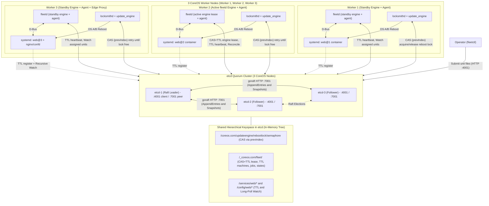
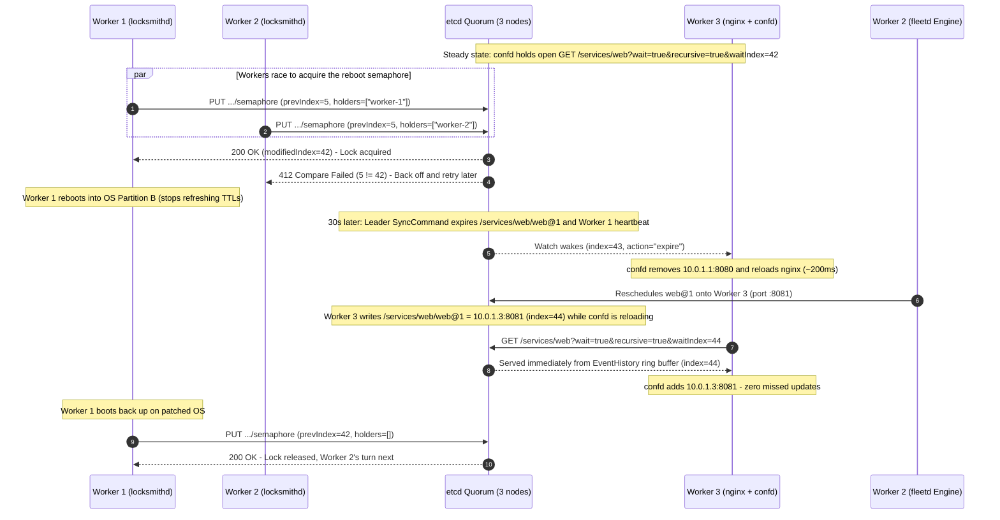

<!--
Series & Authoring Notes (remove before publishing):
- Audience: Systems / database enthusiasts interested in the broader lesson of how changing workloads reshape storage engines.
- Tone: Deeply technical, structured, and educative (self-contained post that bridges naturally into Part 2).
- Shared research notes:
  - ../etcd_storage_history.md (Phase 1: v0.1 – v0.4.x)
  - ../coreos_history.md (Motivating slice: Container Linux A/B updates, locksmith, fleet)
- Local source repositories for code archaeology:
  - ~/Documents/etcd (inspect v0.4.x git tags for `store/`, `server/`, `EventHistory`, JSON snapshots)
  - ~/Documents/goraft (`goraft/raft` — coupling of transport, disk I/O, timers, state machine, locking)
  - ~/Documents/locksmith (`coreos/locksmith` — concrete reboot semaphore example using CAS + TTL)
  - ~/Documents/fleet (`coreos/fleet` — optional secondary CoreOS example)
- Animations:
  - Use Python (`matplotlib`, `numpy`, `pillow`, `imageio`, `imageio-ffmpeg`) to render `.webp` animations embedded directly in this post.
  - See ../../tcp_buffers/pyproject.toml and ../../tcp_buffers/animate_tcp_buffers.py for the established project style and setup.
-->

## Motivation & Series Roadmap

TBD — Hook for systems and database enthusiasts: storage engines are not designed in a vacuum; they are mirrors of the workloads they serve. Today `etcd` is best known as Kubernetes's disk-backed `bbolt` control-plane store, yet it began in 2013 as something radically simpler—an in-memory hierarchical directory tree serialized to JSON.

Introduce the 5-part series roadmap (with Part 1 fully self-contained):

1. **Part 1 (this post):** The Distributed `/etc` & `goraft` Era (`v0.1 – v0.4.x`, 2013–2014)
2. **Part 2:** The `etcd/raft` Rewrite & Hitting the Kubernetes Wall (`v2.0 – v2.3`, 2015)
3. **Part 3:** The `v3` Rewrite & Entering BoltDB (`v3.0 – v3.2`, 2016–2017)
4. **Part 4:** Forking `bbolt` & Scaling to Large Clusters (`v3.3 – v3.5`, 2018–2021)
5. **Part 5:** Retiring `v2store`, Modern Efficiency & Life Beyond `bbolt` (`v3.6 – v3.7` & Alternatives, 2025–2026)

## The 2013 Workload: Why CoreOS Needed a Distributed `/etc`

In 2013, **CoreOS** set out to rethink how server infrastructure was operated. Rather than patching long-lived Linux hosts in place with `apt` or `yum`, **CoreOS Container Linux** shipped a minimal, container-only OS modeled after ChromeOS: just the Linux kernel, `systemd`, a container runtime, and immutable dual-partition (A/B) automatic OS updates. Updates downloaded silently to the passive partition and activated on reboot.

That minimalist design immediately created a coordination problem. Once servers reboot themselves automatically and move containers across a cluster, you need a strongly consistent place to coordinate rolling reboots, schedule services, and share configuration—without hauling a heavy JVM and Apache ZooKeeper onto stripped-down Linux hosts. CoreOS built **`etcd`** (Unix `/etc` + `d` for *distributed* and *daemon*) as a single static Go binary to fill that role.

To make concrete what a "distributed `/etc`" actually meant in practice—and why its workload shaped `etcd`'s earliest storage engine—let's look at how `etcd` sat at the center of a typical CoreOS cluster.

### High-Level System Design: A 6-Node CoreOS Cluster (3 `etcd` + 3 Workers)

*(Raw draft notes — to be condensed later)*

To see what `etcd` actually had to do in 2013–2014, imagine a minimal CoreOS production cluster of **6 machines**: **3 dedicated `etcd` control-plane nodes** and **3 worker nodes** running a stateless 3-replica `web` app (`web@1`, `web@2`, `web@3`) behind a dynamic `nginx` + `confd` load balancer.

- **Why 3 `etcd` nodes instead of running `etcd` on all 6?** Raft needs an odd-sized quorum. Three nodes tolerate 1 node failure while keeping quorum write latency low (and avoiding the replication overhead of a larger consensus group).
- **The key architectural point:** In the early CoreOS stack, **daemons never talk directly to each other**. `fleetd` engines do not open RPC sockets to `fleetd` agents, and `locksmithd` daemons do not gossip. **`etcd` is both the shared state store and the sole coordination bus for the entire cluster.**



*(Note: Because the 3 `etcd` nodes are also CoreOS Container Linux hosts, they run `locksmithd` too—typically in their own semaphore group with `max = 1` so automatic OS updates never reboot two Raft members simultaneously and lose quorum.)*

#### How the Daemons Interact Through `etcd`

1. **Cluster Scheduling (`fleetd` Engine — CAS + TTL Lease & Reconciliation):**
   - Every worker runs `fleetd`, which embeds both an *engine* (scheduler) and an *agent* (executor).
   - To ensure only one scheduler acts at a time, all 3 engines compete for `/_coreos.com/fleet/lease/engine-leader` using **atomic CAS + TTL**. Worker 2 wins the lease and becomes the active engine; Workers 1 and 3 stay standby unless Worker 2's lease expires.
   - When an operator submits units via `fleetctl`, the unit files are written into `etcd`. The active engine reconciles desired vs. actual state and assigns units to workers by writing target machine IDs back into `etcd`.
2. **Node Presence & Container Execution (`fleetd` Agents — TTL Heartbeats & Watches):**
   - All 3 `fleetd` agents periodically refresh a **TTL heartbeat key** (`/_coreos.com/fleet/machines/<id>/object`).
   - Each agent observes units assigned to its machine ID, starts/stops containers through local `systemd` over D-Bus, and reports unit status back to `etcd`.
   - If a worker dies or reboots, its heartbeat TTL expires automatically in `etcd`, telling the active `fleetd` engine to reschedule its containers onto a healthy worker.
3. **Rolling OS Updates (`locksmithd` — Atomic CAS Semaphore):**
   - CoreOS `update_engine` downloads a new OS image to the passive root partition (A/B update) and notifies `locksmithd` over D-Bus (`UPDATE_STATUS_UPDATED_NEED_REBOOT`).
   - `locksmithd` reads `/coreos.com/updateengine/rebootlock/semaphore`, decrements the count, adds its machine ID, and writes it back with **`prevIndex` CAS** (intentionally *without* a TTL, so the lock stays held while the machine is powered down; `locksmithd` unlocks itself once it boots back up).
4. **Service Discovery & Dynamic Config (`web` + `nginx/confd` — Directories, TTLs & Recursive Watches):**
   - Each `web` replica registers its IP:port under `/services/web/` with a 30-second TTL (refreshed every 15s).
   - `nginx` + `confd` on Worker 3 holds open a **recursive long-poll watch** (`GET /v2/keys/services/web?wait=true&recursive=true&waitIndex=...`) to regenerate `nginx.conf` and hot-reload whenever backends come or go (or when static config like `/config/web/rate_limit` changes).

#### What the Entire Cluster's State Looks Like in `etcd`

Before any failure or update occurs, the entire 6-node cluster's state is a tiny filesystem-like tree in `etcd`'s RAM:

```text
/
├── config/
│   └── web/
│       └── rate_limit              = "100rps"          (static config — literal distributed /etc)
├── services/
│   └── web/
│       ├── web@1                   = "10.0.1.1:8080"   (TTL: 30s, running on Worker 1)
│       ├── web@2                   = "10.0.1.2:8080"   (TTL: 30s, running on Worker 2)
│       └── web@3                   = "10.0.1.3:8080"   (TTL: 30s, running on Worker 3)
├── coreos.com/
│   └── updateengine/
│       └── rebootlock/
│           └── semaphore           = '{"semaphore":1,"max":1,"holders":[]}'
└── _coreos.com/
    └── fleet/
        ├── lease/engine-leader     = "worker-2"        (TTL: 15s, CAS lease)
        ├── machines/worker-1..3    = "{...}"           (TTL: 30s heartbeats)
        └── job/web@1..3            = "{unit + target}"
```

Back-of-the-envelope workload tally for this 6-node cluster:

| What's stored in `etcd` | Approximate Keys | Write Pattern |
| :--- | :---: | :--- |
| `locksmithd` reboot semaphores | 1–2 keys | Rare (hours/days) |
| `fleetd` engine lease + 3 machine heartbeats | ~5 keys | Periodic TTL refresh (every ~10–30s) |
| `fleetd` unit definitions & states | ~10–30 keys | Low churn (deploys & failovers) |
| App config & service discovery (`/config/*`, `/services/*`) | ~10–30 keys | Periodic TTL heartbeats |
| **Total working set** | **~30–100 keys (< 1 MB)** | **Single-digit writes/sec** |

---

### Scenario: "Tuesday 3:00 AM — An Automatic CoreOS Kernel Patch Lands"

To see *functionally* what `etcd` must guarantee, trace one routine operational event: CoreOS pushes a security update, and all 3 workers finish downloading it to their passive B-partition at roughly the same time.



Every step of this 3 AM reboot directly motivates a core functional requirement of `etcd`:

1. **The Reboot Race (Steps 1–2) → Linearizable Strong Consistency + Atomic CAS (`prevIndex`):**
   Without linearizable compare-and-swap, all 3 workers could reboot simultaneously and take down the entire `web` service. Raft totally orders all mutations so `etcd` accepts Worker 1's `prevIndex=5` write and rejects Worker 2's with `412 Compare Failed`.
2. **Rebooting/Crashing Without Cleanup (Step 3) → Server-Managed TTLs (`ttlKeyHeap` + `SyncCommand`):**
   A rebooting (or kernel-panicking) machine cannot be trusted to clean up its own keys. TTLs guarantee that both `/services/web/web@1` and Worker 1's `fleetd` heartbeat automatically disappear after 30 seconds—deterministically across all 3 `etcd` nodes.
3. **Traffic Drain & Reschedule Race (Steps 4–6) → Push-Style Watches + Short-Term `EventHistory`:**
   `confd` holds an open recursive long-poll watch on `/services/web` instead of hammering `etcd` with tight polling loops. Crucially, notice the race in Steps 5–6: while `confd` spends ~200ms reloading `nginx` after handling `index=43`, `fleetd` already moves `web@1` onto Worker 3 (`10.0.1.3:8081`) and writes `index=44`. When `confd` reconnects with `waitIndex=44`, it does not miss the new backend *because* `etcd` retains recent mutations in its in-memory `EventHistory` ring buffer.
4. **When an `etcd` Node Itself Reboots → Replicated Durability, Raft Log & Snapshots:**
   The 3 `etcd` nodes also patch themselves one by one via `locksmithd` (`max = 1`). While `etcd-2` reboots, `etcd-1` and `etcd-3` maintain a 2-of-3 quorum. When `etcd-2` boots back up with empty RAM, it reloads its latest full-tree JSON snapshot from disk and replays the tail of its Raft log (plus any missed entries from `etcd-1`) to reconstruct the exact in-memory tree.

- **Storage design lesson:** When your entire cluster's working set is ~30–100 keys (< 1 MB), looks like a Unix directory tree, and sees single-digit writes per second, keeping the entire dataset in RAM + an append-only Raft log + periodic JSON snapshots is a completely pragmatic, rational engineering choice.

## The `v0.x` Data Model & Coordination Primitives

TBD — Explain the hierarchical directory/key API over HTTP+JSON and the three primitives that turned `/etc` into a coordination service:
- **Atomic Compare-and-Swap (`prevValue` / `prevIndex`)**
- **Per-key TTLs** (ephemeral registrations and heartbeats)
- **Long-polling HTTP watches** (`?wait=true&waitIndex=...`)

### Concrete Walkthrough: Minimal `etcd v0.4` Config & Tracing the 3 AM Reboot Over `curl`

*(Raw draft notes — grounded in `~/Documents/etcd` at `v0.4.9` and `~/Documents/locksmith/lock/etcd.go` + `semaphore.go`)*

> **Code archaeology nuance (`locksmith`):** Real `locksmith` (`lock/etcd.go`) uses **CAS (`prevIndex`) *without* a TTL or watch**—deliberately, because a rebooting host must keep holding the semaphore while powered down and unlocks on boot-up (waiting hosts retry with exponential backoff). Pairing `locksmith`'s CAS semaphore with `/services/web/*` service discovery (TTLs + recursive watches) shows all three primitives faithfully.

#### Minimal 3-Node `etcd v0.4` Configuration (`/etc/etcd/etcd.conf`)

In `v0.4`, each control-plane node ran a single static `etcd` binary configured via CLI flags or `/etc/etcd/etcd.conf` (TOML):
- Port `4001`: Client HTTP+JSON API
- Port `7001`: Peer-to-peer `goraft` HTTP traffic
- `data_dir`: Where `goraft` stores `conf`, its append-only `log`, and JSON `snapshot/` files
- `snapshot_count`: Raft commits between full-tree JSON snapshots (default `10000`)

**`etcd-1` (`10.0.0.1` — bootstraps cluster):**
```toml
name = "etcd-1"
addr = "10.0.0.1:4001"
bind_addr = "0.0.0.0:4001"
data_dir = "/var/lib/etcd"
snapshot = true
snapshot_count = 10000

[peer]
addr = "10.0.0.1:7001"
bind_addr = "0.0.0.0:7001"
```

**`etcd-2` (`10.0.0.2` — joins `etcd-1`; `etcd-3` is identical with `10.0.0.3`):**
```toml
name = "etcd-2"
addr = "10.0.0.2:4001"
bind_addr = "0.0.0.0:4001"
data_dir = "/var/lib/etcd"
peers = ["10.0.0.1:7001"]
snapshot = true
snapshot_count = 10000

[peer]
addr = "10.0.0.2:7001"
bind_addr = "0.0.0.0:7001"
```

On disk, `/var/lib/etcd/` only contained:
```text
/var/lib/etcd/
├── conf          # Raft peer metadata
├── log           # Append-only Raft command log
└── snapshot/     # Periodic full-tree JSON dumps
```

#### Concrete HTTP+JSON (`curl`) Interactions From the 3 AM Reboot

1. **Ephemeral service registration (Tree + `ttlKeyHeap`):**
   ```bash
   curl -X PUT http://10.0.0.1:4001/v2/keys/services/web/web@1 \
     -d value="10.0.1.1:8080" \
     -d ttl=30
   ```
   *Under the hood:* `goraft` commits a `Set` command → `store` auto-creates `/services` and `/services/web`, inserts leaf `web@1`, pushes it onto `ttlKeyHeap`, and appends an `Event` to `EventHistory`.

2. **`nginx`/`confd` opens a recursive long-poll watch (`WatcherHub` + `EventHistory`):**
   ```bash
   curl "http://10.0.0.1:4001/v2/keys/services/web?wait=true&recursive=true&waitIndex=42"
   # HTTP connection stays parked in WatcherHub.watchers["/services/web"]
   ```

3. **Worker 1 acquires the `locksmith` reboot semaphore (Atomic CAS via `prevIndex`):**
   After reading `/v2/keys/coreos.com/updateengine/rebootlock/semaphore` (`modifiedIndex: 5`):
   ```bash
   curl -X PUT http://10.0.0.1:4001/v2/keys/coreos.com/updateengine/rebootlock/semaphore \
     -d prevIndex=5 \
     -d value='{"semaphore":0,"max":1,"holders":["worker-1"]}'
   ```
   If Worker 2 races with `prevIndex=5`, Raft serializes both: Worker 1 succeeds (`modifiedIndex: 42`) and Worker 2 gets `101: Compare failed ([5 != 42])`.

4. **Worker 1 reboots → TTL expires → Watcher fires:**
   30s after Worker 1 stops heartbeating, the Raft leader's 500ms `SyncCommand(now)` commits → `store.DeleteExpiredKeys(now)` pops `web@1` off `ttlKeyHeap`, increments `CurrentIndex` to `43`, records an `expire` event in `EventHistory`, and walks `/services/web/web@1` → `/services/web` → `/` to wake `confd`'s hanging `GET`:
   ```json
   {
     "action": "expire",
     "node": { "key": "/services/web/web@1", "modifiedIndex": 43 },
     "prevNode": { "key": "/services/web/web@1", "value": "10.0.1.1:8080" }
   }
   ```
   While `confd` reloads `nginx`, `fleetd` reschedules `web@1` onto Worker 3 (`10.0.1.3:8081`, `index: 44`). When `confd` reconnects with `?wait=true&recursive=true&waitIndex=44`, `EventHistory.scan()` serves `index: 44` immediately from the 1,000-slot ring buffer.

5. **Worker 1 finishes booting → releases the lock via CAS (`prevIndex=42`):**
   ```bash
   curl -X PUT http://10.0.0.1:4001/v2/keys/coreos.com/updateengine/rebootlock/semaphore \
     -d prevIndex=42 \
     -d value='{"semaphore":1,"max":1,"holders":[]}'
   ```

## Under the Hood: `etcd v0.4` & `goraft` (Source-Code Archaeology)

TBD — Trace the end-to-end write/read/watch lifecycle using the exact operations above: Client HTTP (`:4001`) → `goraft` Leader → Raft `log` append & quorum replication (`:7001`) → apply to in-memory `store` (behind `worldLock`) → wake watchers / record in `EventHistory` → periodic JSON snapshot (`monitorSnapshot` every 3s, default `SnapshotCount = 10000`).

*(Verified `v0.4.9` details to highlight below: `store.worldLock sync.RWMutex`, leader `monitorSync()` proposing `SyncCommand(now)` every 500ms through Raft for deterministic TTL expiration via `DeleteExpiredKeys(cutoff)`, `EventHistory` fixed 1,000-slot ring buffer returning `EcodeEventIndexCleared` / `401` on overflow, and `store.Save()` taking `worldLock` to deep-clone `Root` + `EventHistory` + `Stats` before `json.Marshal`.)*

### The In-Memory `store` Tree

TBD — Inspect actual Go structs in `~/Documents/etcd` at a `v0.4.x` tag:
- Hierarchical `node` / directory maps, leaf values, global `currentIndex`, TTL expiration tracking (`ttlKeyHeap` / expiration handling), and locking around reads/writes.

### Watch History (`EventHistory` Ring Buffer)

TBD — Inspect how `EventHistory` maintains a fixed-size in-memory sliding window of recent events so long-polling watchers can catch up from a given `waitIndex`—and what happens when write bursts overflow that window.

TBD — **Animation 1 (Python / `matplotlib` → `.webp`):** *`EventHistory` Ring Buffer & Long-Poll Watches* — visualize writes advancing `currentIndex` and populating the fixed-size ring buffer, a watcher catching up via `waitIndex`, and a slow watcher getting evicted under a write burst.

### Durability & Log Compaction: Raft Command Log + Full-Tree JSON Snapshots

TBD — Explain why an append-only Raft command log cannot grow unboundedly, and inspect `store.Save()` / `SaveNoCopy()` in `etcd v0.4` to show how snapshotting walked the entire Go tree, serialized it to JSON on disk, and truncated the Raft log.

TBD — **Animation 2 (Python / `matplotlib` → `.webp`):** *The Write, Raft Log & Full-Tree JSON Snapshot Lifecycle* — visualize mutations appending to the Raft log and updating the in-memory tree, followed by a snapshot cycle traversing all `N` nodes to serialize JSON and compact the log.

## Mini-Experiment: Measuring the Cost of an In-Memory JSON-Snapshotted Tree

TBD — Reproducible Go benchmark (either exercising historical `etcd v0.4` `store` code directly or a faithful standalone Go harness mirroring its exact structs) scaling from e.g. 1k → 10k → 100k keys to measure:
- **Memory overhead:** Go heap footprint of pointer-heavy directory/node structs vs. raw key/value bytes.
- **Snapshot cost:** Latency, CPU, and allocation spikes of `O(N)` JSON serialization as tree size grows.

Connect the measurements back to fundamental storage trade-offs: blazing-fast point reads and simple crash recovery at 2013 config scale, with steep scaling cliffs waiting once datasets grow.

## Why It Fit 2013—and Where the First Cracks Appeared

TBD — Balanced retrospective grounded in `~/Documents/goraft` and `~/Documents/etcd` (`v0.4.x`):
- **What worked brilliantly:** Single static Go binary, zero external dependencies, intuitive filesystem mental model, fast RAM reads.
- **What broke (`goraft` coupling):** Inspect how `goraft` tightly coupled network transport, disk persistence, timers, and state-machine application behind coarse locking—producing lock contention, brittle network-partition behavior, and hard-to-test failure modes as clusters matured.
- **Latent storage limits:** Full-tree JSON snapshots, Go heap pointer trees, and fixed watch windows were fine at CoreOS config scale, but already ticking time bombs for larger workloads.

## Looking Ahead to Part 2

TBD — Smooth handoff to **Part 2 (`v2.0 – v2.3`)**:
To make `etcd` production-grade, CoreOS replaced `goraft` with a clean-sheet, decoupled state-machine Raft implementation (`etcd/raft`) backed by segmented `wal` and `snap` files. That solved consensus stability—just in time for **Kubernetes v1.0** to adopt `etcd` and push the still-in-memory tree past its breaking point.
