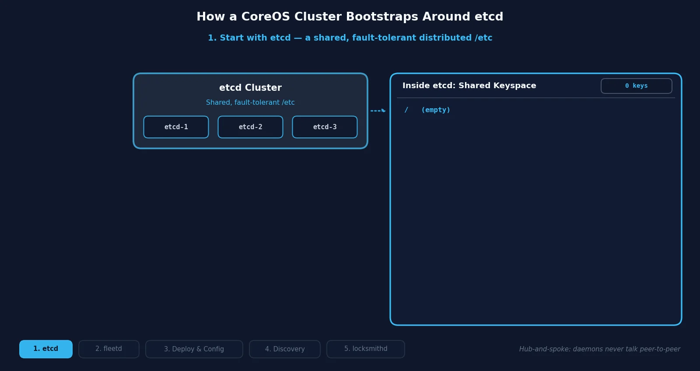
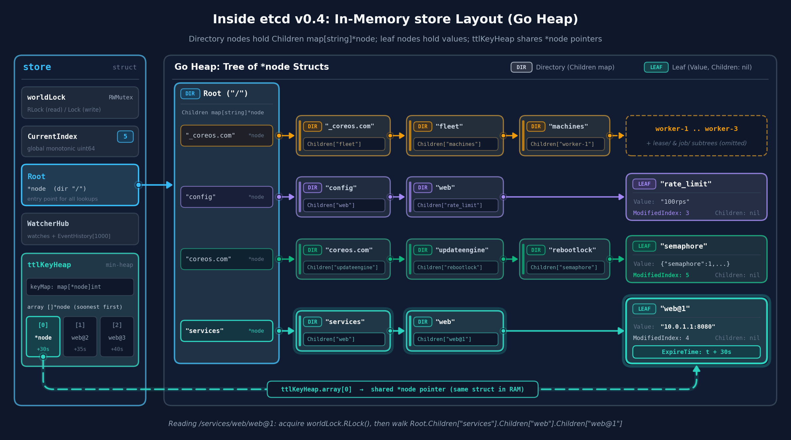
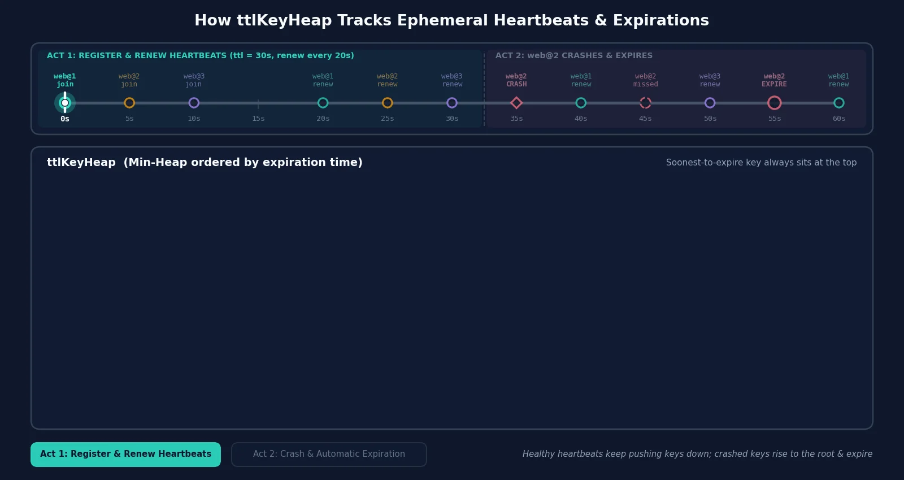
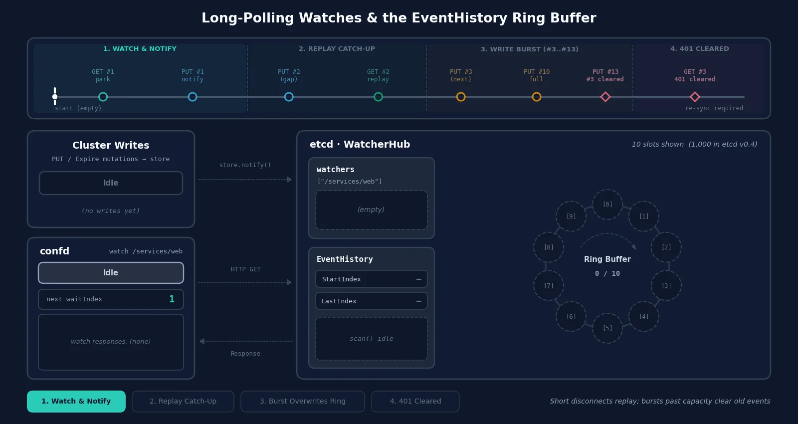
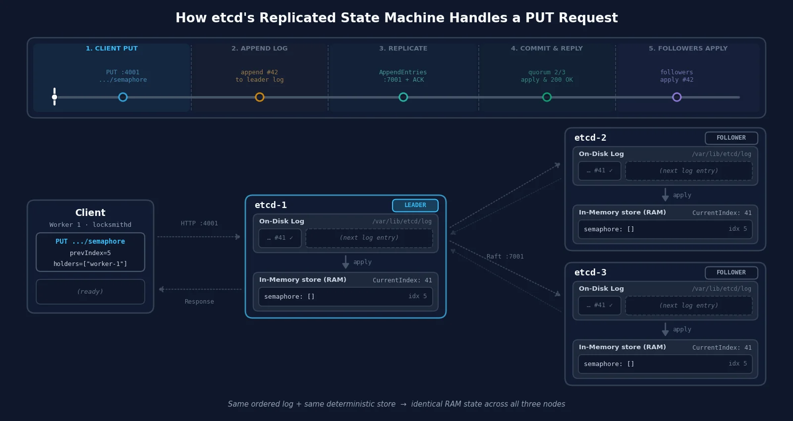
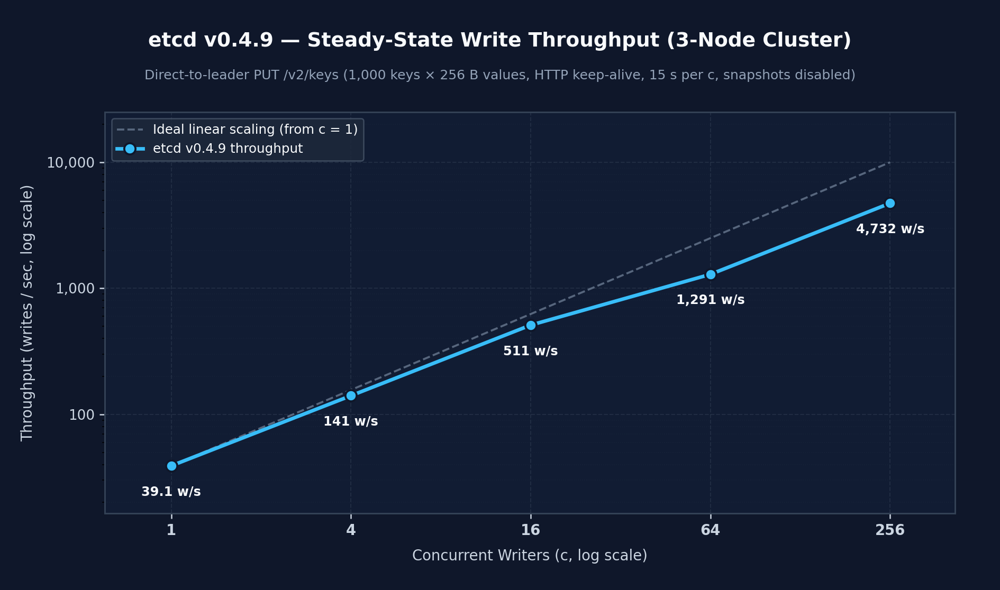
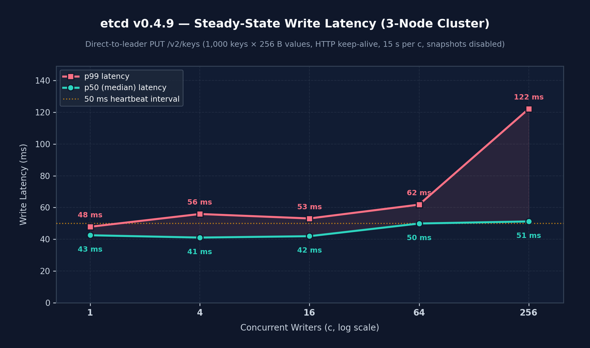

## Motivation & Series Roadmap

Storage engines are shaped by the workloads they are built to serve. Today, `etcd` is best known as the disk-backed datastore behind the Kubernetes control plane. When it started in 2013, however, it was much simpler: an in-memory hierarchical directory tree serialized to JSON.

In this series, we will trace how real-world adoption changed `etcd`'s storage layer over time. This first post starts at the beginning, when small CoreOS configuration trees made keeping everything in memory the obvious choice. In later posts, we will cover the first major reliability overhaul, the arrival of Kubernetes and how it broke those early assumptions, and the move to a disk-backed engine built on BoltDB. From there, we will look at the scaling bottlenecks that led the team to fork BoltDB into `bbolt` and become database maintainers themselves. Finally, we will bring the story up to the present to see how `etcd` moved past its original design and what might come after `bbolt`.

In Part 1, we go back to `etcd v0.1` through `v0.4` (2013-2014). We will look at the original CoreOS workload, inspect the Go code behind its in-memory store and early Raft persistence, and benchmark a 3-node cluster to measure its throughput and latency limits.

## The 2013 Workload: Why CoreOS Needed a Distributed `/etc`

In 2013, CoreOS set out to change how server infrastructure was operated. Instead of patching long-lived Linux hosts in place with `apt` or `yum`, CoreOS Container Linux shipped a minimal, container-only operating system modeled after ChromeOS. It consisted of the Linux kernel, `systemd`, a container runtime, and immutable dual-partition (A/B) automatic OS updates. Updates were downloaded in the background to the passive partition and activated on reboot.

This minimal design created a coordination problem. Once servers reboot automatically and move containers across a cluster, you need a strongly consistent place to coordinate rolling reboots, schedule services, and share configuration. At the same time, CoreOS wanted to avoid running a JVM and Apache ZooKeeper on minimal Linux hosts. To fill this role, they built `etcd` (from Unix `/etc` plus `d` for *distributed* and *daemon*) as a single static Go binary.

To understand what a "distributed `/etc`" meant in practice, and why this workload shaped `etcd`'s first storage engine, let's look at how `etcd` sat at the center of a typical CoreOS cluster.

## Inside a CoreOS Cluster: Bootstrapping Around `etcd`

Consider a small CoreOS cluster running a 3-replica `web` service behind an `nginx` reverse proxy on three worker machines, backed by a dedicated 3-node `etcd` cluster. Having three `etcd` nodes ensures that a single crash or reboot does not take the store down (we will look at how these nodes stay in sync later in this post).

The core design principle of the early CoreOS stack was hub-and-spoke coordination. Daemons on worker machines did not talk directly to each other: schedulers did not open RPC connections to worker agents, and update daemons did not use gossip protocols. Instead, every component only read from and wrote to `etcd`'s shared directory tree:

[](https://raw.githubusercontent.com/FRosner/outpourings/master/bbolt_etcd/part1_distributed_etc_goraft/coreos_cluster_bootstrap.webp)

Going through the bootstrap sequence shows how each part of the cluster maps to a small branch in that tree:

1. **Start with an empty root:** `etcd` starts first as a shared, hierarchical keyspace, similar to a cluster-wide `/etc`.
2. **Workers join via `fleetd`:** Each CoreOS worker starts `fleetd`, registers a liveness heartbeat under `/_coreos.com/fleet/machines/`, and agrees on a single active scheduler (`/_coreos.com/fleet/lease/engine-leader`, held here by Worker 2).
3. **An admin deploys services and config:** Using `fleetctl` and `etcdctl` directly against `etcd` (in 2013-2014, `fleetctl` wrote unit definitions directly into `etcd` without an intermediate API server), an admin submits `web@1..3` and `nginx` along with shared application config such as `/config/web/rate_limit`. The active `fleetd` scheduler assigns those units to workers, which then start the containers locally.
4. **Running containers register for discovery:** Once running, each `web` replica publishes its `IP:port` under `/services/web/`. On Worker 3, `nginx` (driven by a lightweight template helper like `confd`) watches `/services/web/` so traffic is routed only to healthy backends.
5. **OS updates take turns via `locksmithd`:** Every worker also runs `locksmithd`, which coordinates around a reboot semaphore under `/coreos.com/updateengine/rebootlock/semaphore`. This makes sure automatic A/B OS updates reboot one machine at a time instead of taking the whole cluster offline at once. *(The `etcd` nodes themselves run `locksmithd` in their own one-at-a-time group for the same reason.)*

It is worth noting how little data `etcd` actually holds once the cluster is up and running. The animation compresses each unit into a single line (13 keys in total). Even in a real CoreOS cluster, where `fleet` splits each unit across several internal subkeys (`object`, `target`, `state`), the entire working set consists of only a few dozen small keys. Total data size stays well under 1 MB, with a small, steady stream of periodic heartbeat writes.

## Storing `/etc` in RAM: Inside `etcd v0.4`'s `store`

When the entire cluster's working set fits into a few hundred kilobytes, there is little reason to build an on-disk B+tree or an LSM-tree. Early `etcd` (`v0.1` to `v0.4`) had no embedded database engine at all. Its primary storage engine was an in-memory Go directory tree (`store`), exposed over a simple HTTP+JSON API on port `4001`.

Looking at [`store/store.go`](https://github.com/etcd-io/etcd/blob/v0.4.9/store/store.go#L66-L74) in `etcd v0.4.9`, the whole storage engine is represented by a single seven-field struct:

```go
// store/store.go (etcd v0.4.9)
type store struct {
	Root           *node
	WatcherHub     *watcherHub
	CurrentIndex   uint64
	Stats          *Stats
	CurrentVersion int
	ttlKeyHeap     *ttlKeyHeap  // need to recovery manually
	worldLock      sync.RWMutex // stop the world lock
}
```

Each coordination pattern from our CoreOS bootstrap walkthrough maps directly to one of these fields:

| CoreOS Cluster Need | HTTP+JSON Primitive | Backing In-Memory Structure |
| :--- | :--- | :--- |
| Hierarchical `/etc` paths (`fleet`, `/config/*`) | Directory / leaf CRUD | `Root *node` tree (`Children map[string]*node`) |
| Mutual exclusion (`locksmithd` semaphore, `fleetd` leader lease) | Atomic CAS (`prevIndex` / `prevValue`) | Monotonic `CurrentIndex` + `worldLock` |
| Ephemeral liveness (`fleetd` heartbeats, `web@1..3` registration) | Per-key TTLs (`ttl=30`) | `ttlKeyHeap` min-heap |
| Reactive config (`nginx`/`confd` following `/services/web/`) | Long-polling watches (`?wait=true`) | `WatcherHub` + 1,000-slot `EventHistory` ring buffer |

Let's look at how each of these four components works in the code.

### The Directory Tree, `worldLock`, and Atomic CAS

The root of the store is a Unix-like tree of `node` structs ([`store/node.go`](https://github.com/etcd-io/etcd/blob/v0.4.9/store/node.go#L25-L40)):

```go
// store/node.go (etcd v0.4.9)
type node struct {
	Path string

	CreatedIndex  uint64
	ModifiedIndex uint64

	Parent *node `json:"-"` // should not encode this field! avoid circular dependency.

	ExpireTime time.Time
	ACL        string
	Value      string           // for key-value pair
	Children   map[string]*node // for directory

	store *store
}
```

A node is either a **leaf** (holding a `Value` string with `Children == nil`) or a **directory** (holding a `Children map[string]*node` keyed by path segment). In memory, our CoreOS cluster's keyspace forms a nested tree of Go structs and maps, with `ttlKeyHeap` holding direct pointers to the same ephemeral `*node` structs:

[](https://raw.githubusercontent.com/FRosner/outpourings/master/bbolt_etcd/part1_distributed_etc_goraft/store_memory_layout.png)

Reading `/services/web/web@1` acquires `worldLock.RLock()`, splits the path, and walks `Root.Children["services"].Children["web"].Children["web@1"]`. Every write acquires the exclusive `worldLock.Lock()` (commented `// stop the world lock` in the source code), increments the store's global monotonic `CurrentIndex`, and updates the affected node's `ModifiedIndex`.

Having a single global lock and a monotonic index makes **Compare-and-Swap (CAS)** straightforward to implement. Take `locksmithd` coordinating a 3 AM OS reboot on Worker 1 as an example. First, `locksmithd` reads `/coreos.com/updateengine/rebootlock/semaphore` and sees `modifiedIndex: 5`. To claim the reboot slot, it sends a conditional `PUT` with `prevIndex=5`:

```bash
curl -X PUT http://10.0.0.1:4001/v2/keys/coreos.com/updateengine/rebootlock/semaphore \
  -d prevIndex=5 \
  -d value='{"semaphore":0,"max":1,"holders":["worker-1"]}'
```

*Note that `locksmith` intentionally [acquires](https://github.com/coreos/locksmith/blob/v0.2.3/lock/etcd.go#L82-L95) this semaphore with `prevIndex` without a TTL or watch. A rebooting host must keep holding the slot while powered off and only releases it via another CAS after booting back up. Other hosts retry with exponential backoff.*

In `store.CompareAndSwap` ([`store/store.go`](https://github.com/etcd-io/etcd/blob/v0.4.9/store/store.go#L199-L250)), the check and update run atomically under `worldLock`:

```go
// store/store.go (etcd v0.4.9, trimmed)
func (s *store) CompareAndSwap(nodePath, prevValue string, prevIndex uint64,
	value string, expireTime time.Time) (*Event, error) {

	s.worldLock.Lock()
	defer s.worldLock.Unlock()

	n, err := s.internalGet(nodePath)
	if err != nil {
		return nil, err
	}
	if ok, which := n.Compare(prevValue, prevIndex); !ok {
		cause := getCompareFailCause(n, which, prevValue, prevIndex)
		return nil, etcdErr.NewError(etcdErr.EcodeTestFailed, cause, s.CurrentIndex)
	}

	s.CurrentIndex++
	// ... record Event with PrevNode ...
	n.Write(value, s.CurrentIndex)
	n.UpdateTTL(expireTime)
	s.WatcherHub.notify(e)
	return e, nil
}
```

If Worker 1 and Worker 2 both send a request with `prevIndex=5` at the same time, whichever request runs first advances the node to `modifiedIndex: 42`. The second request fails `n.Compare` and receives `101: Compare failed ([5 != 42])`.

### Ephemeral Keys and `ttlKeyHeap`

Unlike the reboot semaphore, service registrations and machine heartbeats need to disappear automatically if a worker crashes. When `web@1` starts on Worker 1, it registers an ephemeral key with a 30-second TTL:

```bash
curl -X PUT http://10.0.0.1:4001/v2/keys/services/web/web@1 \
  -d value="10.0.1.1:8080" \
  -d ttl=30
```

When `store` inserts `/services/web/web@1` (auto-creating `/services` and `/services/web` along the way), it detects a non-zero `ExpireTime` and registers the `*node` pointer in `ttlKeyHeap` ([`store/ttl_key_heap.go`](https://github.com/etcd-io/etcd/blob/v0.4.9/store/ttl_key_heap.go#L8-L74)). Instead of keeping a plain slice or scanning every key in the tree to find expired entries, `ttlKeyHeap` implements Go's standard library `container/heap.Interface` (`Len`, `Less`, `Swap`, `Push`, `Pop`):

```go
// store/ttl_key_heap.go (etcd v0.4.9, trimmed)
type ttlKeyHeap struct {
	array  []*node
	keyMap map[*node]int
}

func (h ttlKeyHeap) Len() int {
	return len(h.array)
}

func (h ttlKeyHeap) Less(i, j int) bool {
	return h.array[i].ExpireTime.Before(h.array[j].ExpireTime)
}

func (h ttlKeyHeap) Swap(i, j int) {
	h.array[i], h.array[j] = h.array[j], h.array[i]

	// Keep each node's current slice index up to date
	h.keyMap[h.array[i]] = i
	h.keyMap[h.array[j]] = j
}

func (h *ttlKeyHeap) Push(x interface{}) {
	n, _ := x.(*node)
	h.keyMap[n] = len(h.array)
	h.array = append(h.array, n)
}

func (h *ttlKeyHeap) Pop() interface{} {
	old := h.array
	n := len(old)
	x := old[n-1]
	h.array = old[0 : n-1]
	delete(h.keyMap, x)
	return x
}

func (h *ttlKeyHeap) update(n *node) {
	if index, ok := h.keyMap[n]; ok {
		heap.Remove(h, index)
		heap.Push(h, n)
	}
}
```

Two details explain how this data structure works:

1. **Ordering `array` by `ExpireTime` so `array[0]` always expires first:** Go's `container/heap` treats the flat slice `array` as an implicit binary tree where the children of index `i` are at `2*i + 1` and `2*i + 2`. Whenever `etcd` inserts or removes a node via `heap.Push` or `heap.Pop`, `container/heap` calls `Less(i, j)` to compare `ExpireTime` on the `*node` pointers and swaps elements up or down a single root-to-leaf path (`O(log N)`). This preserves the min-heap invariant: every parent expires earlier than both of its children. As a result, the key that expires soonest always sits at `array[0]`, so checking whether any key is due to expire takes `O(1)` time.
2. **Tracking positions with `keyMap` for heartbeat refreshes and early deletes:** A plain binary heap only gives direct access to the earliest element (`array[0]`). When `web@1` refreshes its 30-second heartbeat (`UpdateTTL`) or is deleted manually, `store` finds the `*node` through the directory tree rather than the heap, so it does not know which index `i` in `array` that node currently occupies. Because `Push`, `Pop`, and `Swap` keep `keyMap[node] = i` synchronized on every move, `update(n)` and `remove(n)` can find the node's slice index in `O(1)` and rebalance via `heap.Remove` and `heap.Push` in `O(log N)`, avoiding a linear scan of the slice.

Expiring overdue keys then becomes a simple loop in [`store.DeleteExpiredKeys(cutoff time.Time)`](https://github.com/etcd-io/etcd/blob/v0.4.9/store/store.go#L565-L592):

```go
// store/store.go (etcd v0.4.9, trimmed)
func (s *store) DeleteExpiredKeys(cutoff time.Time) {
	s.worldLock.Lock()
	defer s.worldLock.Unlock()

	for {
		node := s.ttlKeyHeap.top()
		if node == nil || node.ExpireTime.After(cutoff) {
			break
		}

		s.CurrentIndex++
		e := newEvent(Expire, node.Path, s.CurrentIndex, node.CreatedIndex)
		e.PrevNode = node.Repr(false, false)

		s.ttlKeyHeap.pop()
		node.Remove(true, true, func(path string) {
			s.WatcherHub.notifyWatchers(e, path, true)
		})
		s.WatcherHub.notify(e)
	}
}
```

The animation below shows this behavior across our three `web` replicas (`ttl=30s`). Healthy renewals keep pushing keys down below the root, while a crashed container eventually moves to the top and expires once its timestamp is reached:

[](https://raw.githubusercontent.com/FRosner/outpourings/master/bbolt_etcd/part1_distributed_etc_goraft/ttl_key_heap.webp)

Note one important detail in the signature of `DeleteExpiredKeys`: it does not call `time.Now()` itself, and instead takes an explicit `cutoff time.Time` parameter. If three `etcd` nodes expired keys using their own local wall clocks, clock skew would cause them to expire keys at different points relative to incoming writes, leading to diverging trees and different `CurrentIndex` values. We will see in the next section how `etcd` solves this through Raft.

### Long-Polling Watches: `WatcherHub` and the `EventHistory` Ring Buffer

On Worker 3, `nginx` (driven by a template helper like `confd`) needs to learn immediately when `/services/web/web@1` disappears during Worker 1's reboot, without polling `etcd` in a tight loop. In `v0.4`, watches were implemented as **HTTP long-polling** ("hanging GET") requests:

```bash
curl "http://10.0.0.1:4001/v2/keys/services/web?wait=true&recursive=true&waitIndex=42"
```

Inside `store`, watches are managed by `watcherHub` ([`store/watcher_hub.go`](https://github.com/etcd-io/etcd/blob/v0.4.9/store/watcher_hub.go#L19-L24)):

```go
// store/watcher_hub.go (etcd v0.4.9)
type watcherHub struct {
	mutex        sync.Mutex
	watchers     map[string]*list.List
	count        int64
	EventHistory *EventHistory
}
```

When no matching change has happened yet, [`watcherHub.watch()`](https://github.com/etcd-io/etcd/blob/v0.4.9/store/watcher_hub.go#L41) allocates a buffered `EventChan` and stores the watcher in `watchers["/services/web"]`, keeping the HTTP request open. Thirty seconds after Worker 1 powers down for its OS update, `DeleteExpiredKeys` removes `web@1` at `CurrentIndex = 43` and calls [`WatcherHub.notify(e)`](https://github.com/etcd-io/etcd/blob/v0.4.9/store/watcher_hub.go#L95). `notify` splits `e.Node.Key` (`/services/web/web@1`) on `"/"` and walks every ancestor prefix (`/`, `/services`, `/services/web`, `/services/web/web@1`), waking `confd`'s open GET request with a JSON response:

```json
{
  "action": "expire",
  "node": { "key": "/services/web/web@1", "modifiedIndex": 43 },
  "prevNode": { "key": "/services/web/web@1", "value": "10.0.1.1:8080" }
}
```

Because each HTTP long-poll delivers only a single event and closes the connection, there is a small gap while `confd` reloads `nginx` and opens its next `?wait=true` request. During that window, `fleetd` can reschedule `web@1` onto Worker 3 (`10.0.1.3:8081`, `CurrentIndex = 44`). If `etcd` only notified currently waiting clients, `confd` would miss index `44`.

To bridge this gap, `watcherHub` maintains `EventHistory` ([`store/event_history.go`](https://github.com/etcd-io/etcd/blob/v0.4.9/store/event_history.go#L12-L17) and [`store/event_queue.go`](https://github.com/etcd-io/etcd/blob/v0.4.9/store/event_queue.go#L3-L9)), an in-memory fixed-size ring buffer initialized to 1,000 events (`newWatchHub(1000)` in [`store/store.go`](https://github.com/etcd-io/etcd/blob/v0.4.9/store/store.go#L80-L88)):

```go
// store/event_history.go & store/event_queue.go (etcd v0.4.9)
type EventHistory struct {
	Queue      eventQueue
	StartIndex uint64
	LastIndex  uint64
	rwl        sync.RWMutex
}

type eventQueue struct {
	Events   []*Event
	Size     int
	Front    int
	Back     int
	Capacity int // hardcoded to 1000 in newStore()
}
```

When `confd` reconnects with `?wait=true&recursive=true&waitIndex=44`, [`EventHistory.scan()`](https://github.com/etcd-io/etcd/blob/v0.4.9/store/event_history.go#L44-L89) checks the ring buffer before parking the request:

1. **Future index (`waitIndex > LastIndex`):** There is nothing to replay yet, so `etcd` parks the watcher in `watchers["/services/web"]`.
2. **In-window index (`StartIndex <= waitIndex <= LastIndex`):** `scan()` jumps directly to `(Queue.Front + int(waitIndex - StartIndex)) % 1000` and scans forward for the first matching event. It immediately returns index `44`, allowing `confd` to catch up without missing any updates.
3. **Cleared index (`waitIndex < StartIndex`):** More than 1,000 mutations have occurred since the watcher last checked in, so its slot in the ring buffer has been overwritten. `scan()` aborts with error `401` (`EcodeEventIndexCleared`: *"The event in requested index is outdated and cleared"*), forcing the client to perform a full recursive `GET` to resynchronize.

The animation below shows all three cases on a scaled-down 10-slot ring buffer: a live watch waking on `#1`, a quick reconnect replaying `#2` from history, and a burst of writes wrapping around to clear `#3`:

[](https://raw.githubusercontent.com/FRosner/outpourings/master/bbolt_etcd/part1_distributed_etc_goraft/event_history_ring_buffer.webp)

The source comment right above `newWatchHub` in [`store/watcher_hub.go`](https://github.com/etcd-io/etcd/blob/v0.4.9/store/watcher_hub.go#L26-L35) shows the exact 2013 workload assumption behind that buffer size:

```go
// Typically, we only need to keep a small size of history[smaller than 20K].
// Ideally, it should smaller than 20K/s[max throughput] * 2 * 50ms[RTT] = 2000
```

For a quiet CoreOS cluster with dozens of keys and light heartbeat traffic, 1,000 events could cover minutes of history. In a busy cluster, however, that buffer can fill up and wrap around in milliseconds.

---

So far, everything we have looked at is an in-memory directory tree living inside volatile Go heap memory on a single machine. This immediately raises two questions:

1. **Durability:** If `etcd-1` crashes or reboots under `locksmithd`, how does the tree survive?
2. **Consistency:** With three `etcd` nodes running concurrently, how do they agree on who won `locksmithd`'s CAS, keep `CurrentIndex` identical, and expire TTLs at the same point?

## Making RAM Durable and Replicated: `goraft`, the Command Log, and JSON Snapshots

In `etcd v0.1` through `v0.4`, durability and replication were not separate layers. Instead, Raft itself served as the on-disk storage layer. Early `etcd` embedded Ben Johnson's [`github.com/goraft/raft`](https://github.com/goraft/raft), one of the first Go implementations of the [Raft consensus algorithm](https://raft.github.io/).

We will not go into Raft's leader-election proofs or term safety here (for an interactive walkthrough of those mechanics, see [The Secret Lives of Data](https://thesecretlivesofdata.com/raft/)). To understand `etcd`'s storage evolution, the main concept we need is the **Replicated State Machine (RSM)**.

Every `etcd` node runs the same deterministic in-memory `store` we just looked at. Rather than replicating raw memory pages or full key-value snapshots on every write, Raft replicates an ordered, append-only log of commands across the three nodes:

[](https://raw.githubusercontent.com/FRosner/outpourings/master/bbolt_etcd/part1_distributed_etc_goraft/replicated_state_machine.webp)

Following the five steps in the animation shows how `locksmithd`'s CAS request flows through `goraft`:

1. **Client PUT:** Worker 1 sends `PUT /v2/keys/coreos.com/updateengine/rebootlock/semaphore?prevIndex=5` to port `4001`. (If the request hits a follower, `etcd` redirects or proxies the write to the leader.) The leader wraps the request in a [`CompareAndSwapCommand`](https://github.com/etcd-io/etcd/blob/v0.4.9/store/v2/compare_and_swap_command.go#L16-L41) (`etcd:compareAndSwap`) and passes it to `raftServer.Do(cmd)`.
2. **Append Log:** Inside `goraft`'s [`leaderLoop`](https://github.com/etcd-io/etcd/blob/v0.4.9/third_party/github.com/goraft/raft/server.go#L812), [`processCommand`](https://github.com/etcd-io/etcd/blob/v0.4.9/third_party/github.com/goraft/raft/server.go#L902) creates a `LogEntry` (`#42`) and encodes the JSON command into the leader's local `/var/lib/etcd/log` file.
3. **Replicate:** Peer heartbeat goroutines replicate `#42` over port `7001` via `AppendEntries`. Each follower appends the entry to its own `/var/lib/etcd/log` and replies with an acknowledgment.
4. **Commit & Reply:** Once a majority (2 of 3 nodes) has persisted `#42`, the leader advances `commitIndex`. [`Log.setCommitIndex()`](https://github.com/etcd-io/etcd/blob/v0.4.9/third_party/github.com/goraft/raft/log.go#L331-L385) decodes the command and invokes `ApplyFunc` → `CompareAndSwapCommand.Apply()` → `store.CompareAndSwap(...)`. Only after the leader updates its in-memory `store` and notifies `WatcherHub` does it return HTTP `200 OK` (with `modifiedIndex: 42`) to Worker 1.
5. **Followers Apply:** Once followers receive the updated `commitIndex`, each runs the same `Log.setCommitIndex()` → `store.CompareAndSwap(...)` path against its own in-memory tree. If Worker 2 concurrently sent `prevIndex=5`, its command lands at a later log index, applies after Worker 1's command, and deterministically fails with `101: Compare failed` on every replica.

Because every node starts from the same empty `/` and applies the same committed commands in the same order, every replica arrives at the same in-memory tree, the same `CurrentIndex`, and the same CAS winners. If a node reboots, it recovers its in-memory state from disk.

### Deterministic TTL Expiration via `SyncCommand`

This command-log mechanism also answers the question from the previous section: how do three independent nodes expire TTLs deterministically without relying on local wall clocks?

In [`server/peer_server.go`](https://github.com/etcd-io/etcd/blob/v0.4.9/server/peer_server.go#L792-L805), the Raft leader runs a 500 ms background ticker (`monitorSync`) that proposes a `SyncCommand` carrying the leader's timestamp into the Raft log:

```go
// server/peer_server.go (etcd v0.4.9)
func (s *PeerServer) monitorSync() {
	ticker := time.NewTicker(time.Millisecond * 500)
	defer ticker.Stop()
	for {
		select {
		case <-s.closeChan:
			return
		case now := <-ticker.C:
			if s.raftServer.State() == raft.Leader {
				s.raftServer.Do(s.store.CommandFactory().CreateSyncCommand(now))
			}
		}
	}
}
```

When each replica commits and applies that `etcd:sync` log entry ([`store/v2/sync_command.go`](https://github.com/etcd-io/etcd/blob/v0.4.9/store/v2/sync_command.go#L14-L28)), it passes the leader's serialized `c.Time` directly into `s.DeleteExpiredKeys(c.Time)`. Every node pops the same expired entries from its `ttlKeyHeap` at the same point in the log, incrementing `CurrentIndex` identically.

Note a subtle storage side effect here: even a completely idle `etcd v0.4` cluster writes two `etcd:sync` commands per second into the Raft log, which adds up to roughly 172,800 log entries per day.

### Log Compaction and Full-Tree JSON Snapshots

An append-only command log cannot grow forever. Without compaction, `/var/lib/etcd/log` would eventually fill up the disk, and restarting a node would require replaying millions of historical mutations from index 1 just to reconstruct a 50 KB tree.

Raft solves unbounded log growth with **snapshotting**: periodically write the state machine's full state to disk at some committed log index `L`, then discard all log entries up to `L`. This gives `/var/lib/etcd/` in `etcd v0.4` a very simple on-disk layout. There are no database files, page caches, or indexes, only three items:

```text
/var/lib/etcd/
├── conf                  # Raft peer configuration metadata
├── log                   # Single append-only Raft command log
└── snapshot/
    └── <term>_<index>.ss # Periodic CRC32-prefixed JSON dump of the entire store
```

In `etcd v0.4.9`, `PeerServer.monitorSnapshot()` ([`server/peer_server.go`](https://github.com/etcd-io/etcd/blob/v0.4.9/server/peer_server.go#L772-L790)) wakes up every 3 seconds and checks whether `CommitIndex - lastSnapshotIndex` exceeds `snapshot_count` (default `10000` entries). Because of the 500 ms `SyncCommand`, this threshold is reached at least every ~83 minutes even with zero user writes. When it crosses that threshold, it calls [`raftServer.TakeSnapshot()`](https://github.com/etcd-io/etcd/blob/v0.4.9/third_party/github.com/goraft/raft/server.go#L1188-L1241):

1. **Stop-the-world clone and JSON serialization ([`store.Save()`](https://github.com/etcd-io/etcd/blob/v0.4.9/store/store.go#L620-L639)):**
   `goraft` asks the state machine (`store`) to serialize itself:

   ```go
   // store/store.go (etcd v0.4.9)
   func (s *store) Save() ([]byte, error) {
   	s.worldLock.Lock()

   	clonedStore := newStore()
   	clonedStore.CurrentIndex = s.CurrentIndex
   	clonedStore.Root = s.Root.Clone()
   	clonedStore.WatcherHub = s.WatcherHub.clone()
   	clonedStore.Stats = s.Stats.clone()
   	clonedStore.CurrentVersion = s.CurrentVersion

   	s.worldLock.Unlock()

   	b, err := json.Marshal(clonedStore)
   	if err != nil {
   		return nil, err
   	}
   	return b, nil
   }
   ```

   To avoid holding `worldLock` during slow JSON encoding, `store.Save()` first takes the exclusive `worldLock.Lock()` (blocking all reads and writes) and performs a full recursive deep copy of all `N` nodes in [`Root.Clone()`](https://github.com/etcd-io/etcd/blob/v0.4.9/store/node.go#L355-L367), along with `EventHistory` and `Stats`. Only after allocating a second copy of the entire keyspace in RAM does it release `worldLock` and run `json.Marshal(clonedStore)` on the clone.

2. **Double-encoded snapshot file ([`goraft/raft/snapshot.go`](https://github.com/etcd-io/etcd/blob/v0.4.9/third_party/github.com/goraft/raft/snapshot.go#L55-L86)):**
   `goraft`'s `Snapshot.save()` wraps those `state` JSON bytes inside an outer `Snapshot{LastIndex, LastTerm, Peers, State}` struct and calls `json.Marshal(ss)` a second time (which base64-encodes `State []byte` inside the outer JSON object). It then writes an 8-character CRC32 checksum followed by the payload to `snapshot/<term>_<index>.ss`, calls `file.Sync()`, and deletes the previous snapshot file:

   ```text
   # /var/lib/etcd/snapshot/1_10001.ss
   a3f9c210                                           ◄── 8-char IEEE CRC32 checksum
   {
     "lastIndex": 10001, "lastTerm": 1,
     "peers": [{"name": "etcd-1", "connectionString": "http://10.0.0.1:7001"}, ...],
     "state": "eyJSb290Ijp7IlBhdGgiOiIvIiwiQ2hpbGRyZW4iOnsi..."  ◄── base64(json(store))
   }
   ```

3. **Log rewrite and truncation ([`goraft/raft/log.go`](https://github.com/etcd-io/etcd/blob/v0.4.9/third_party/github.com/goraft/raft/log.go#L568-L624)):**
   Once the snapshot is synced, `goraft` keeps a 200-entry safety tail ([`NumberOfLogEntriesAfterSnapshot = 200`](https://github.com/etcd-io/etcd/blob/v0.4.9/third_party/github.com/goraft/raft/server.go#L34)) so slightly lagging followers can still catch up via `AppendEntries` instead of transferring a full snapshot. It calls `s.log.compact()`, which locks `Log.mutex`, writes those surviving tail entries into `log.new`, calls `file.Sync()`, and atomically replaces `log` with `log.new` using `os.Rename`.

4. **Crash recovery ([`store.Recovery()`](https://github.com/etcd-io/etcd/blob/v0.4.9/store/store.go#L645-L658)):**
   When a node restarts, it reads the latest `<term>_<index>.ss` file, unmarshals the JSON tree back into RAM, and walks every node via [`Root.recoverAndclean()`](https://github.com/etcd-io/etcd/blob/v0.4.9/store/node.go#L376-L389) to reconstruct fields that JSON could not encode (`Parent` pointers marked `json:"-"` and the unexported `ttlKeyHeap`). Finally, it replays whatever entries remain in `/var/lib/etcd/log`.

Every step of this pipeline is easy to understand, but it scales linearly (`O(N)`) with the total size of the tree in RAM, CPU, and disk I/O.

## Evaluating the v0.4 Design: Strengths and Limitations

For the 2013 CoreOS Container Linux workload, `etcd v0.1` to `v0.4` was a pragmatic design. It shipped as a single static Go binary with zero external dependencies, gave operators a familiar filesystem model they could inspect with `curl`, served reads in microseconds from RAM, and recovered state from plain files in `/var/lib/etcd/`. When a cluster only coordinated a few dozen keys across `fleet`, `locksmith`, and `confd`, this simplicity allowed CoreOS to ship quickly.

However, as clusters moved from early prototypes into production deployments in 2014, serious limitations emerged. Most of them stemmed from `goraft` (the consensus and persistence engine underneath `store`) and how it interacted with snapshotting. They fell into three areas: **coupling and testability**, **persistence correctness**, and **write-path performance**.

### Testability and Coupling in `goraft`

Inside [`third_party/github.com/goraft/raft/`](https://github.com/etcd-io/etcd/tree/v0.4.9/third_party/github.com/goraft/raft), `goraft`'s [`server`](https://github.com/etcd-io/etcd/blob/v0.4.9/third_party/github.com/goraft/raft/server.go#L111-L150) struct combined every layer of the system into a single stateful object:

- **Network transport:** Direct HTTP client and server calls ([`http_transporter.go`](https://github.com/etcd-io/etcd/blob/v0.4.9/third_party/github.com/goraft/raft/http_transporter.go)) and per-peer background goroutines.
- **Timers and goroutine lifecycles:** Wall-clock `time.Tick` and `time.After` channels driving [`leaderLoop`](https://github.com/etcd-io/etcd/blob/v0.4.9/third_party/github.com/goraft/raft/server.go#L817), [`followerLoop`](https://github.com/etcd-io/etcd/blob/v0.4.9/third_party/github.com/goraft/raft/server.go#L669), and [`candidateLoop`](https://github.com/etcd-io/etcd/blob/v0.4.9/third_party/github.com/goraft/raft/server.go#L731).
- **Disk I/O:** Direct `os.File` seeks, writes, renames, and `fsync` calls inside [`Log`](https://github.com/etcd-io/etcd/blob/v0.4.9/third_party/github.com/goraft/raft/log.go) and [`Snapshot.save()`](https://github.com/etcd-io/etcd/blob/v0.4.9/third_party/github.com/goraft/raft/snapshot.go#L55-L86).
- **Synchronous state-machine execution:** [`Log.setCommitIndex()`](https://github.com/etcd-io/etcd/blob/v0.4.9/third_party/github.com/goraft/raft/log.go#L331-L385) decoded each entry and invoked `l.ApplyFunc(entry, command)` synchronously while holding `Log.mutex.Lock()`.

Consensus protocols are hardest to get right in rare failure scenarios, such as asymmetric network partitions, dropped or reordered RPCs, sudden leader step-downs, and partial disk writes. Because `goraft` coupled live sockets, wall-clock timers, coarse mutexes, and `os.File` handles directly into the protocol state machine, deterministic unit testing was almost impossible. Edge cases had to be reproduced through timing-dependent multi-goroutine tests, which made subtle split-brain and cluster-membership bugs hard to isolate and fix.

### Persistence and Snapshot Correctness

On disk, the persistence format introduced two notable data-integrity hazards:

- **Unchecksummed log entries:** While `.ss` snapshot files included a CRC32 checksum, `/var/lib/etcd/log` had no per-entry integrity check. In [`LogEntry.Encode()`](https://github.com/etcd-io/etcd/blob/v0.4.9/third_party/github.com/goraft/raft/log_entry.go#L72-L83), `goraft` wrote an 8-character ASCII hex length (`fmt.Fprintf(w, "%8x\n", len(b))`) followed by raw protobuf bytes (`w.Write(b)`). Silent bitrot or a corrupted sector in the log went undetected during replay as long as the bytes still unmarshaled as valid protobuf.
- **Racy snapshot boundaries:** [`server.TakeSnapshot()`](https://github.com/etcd-io/etcd/blob/v0.4.9/third_party/github.com/goraft/raft/server.go#L1188-L1218) contained an explicit `TODO` in `etcd v0.4.9`'s production code:

  ```go
  // third_party/github.com/goraft/raft/server.go (etcd v0.4.9)
  func (s *server) TakeSnapshot() error {
  	// ...
  	// TODO: acquire the lock and no more committed is allowed
  	// This will be done after finishing refactoring heartbeat
  	s.debugln("take.snapshot")

  	lastIndex, lastTerm := s.log.commitInfo()
  	// ...
  	state, err := s.stateMachine.Save()
  ```

  Because `TakeSnapshot()` read `lastIndex` before calling `s.stateMachine.Save()` without blocking concurrent commits, new mutations could be applied to `store` in the gap. This could produce a snapshot file whose serialized `State` had already moved past its recorded `LastIndex`.

### Write-Path Performance and Compaction Stalls

Even on a healthy network without failures, `goraft`'s write and compaction paths had significant bottlenecks. Two of them governed steady-state writes before log compaction ran.

**Timer-polled, stop-and-wait replication.** In [`server.processCommand()`](https://github.com/etcd-io/etcd/blob/v0.4.9/third_party/github.com/goraft/raft/server.go#L907-L926), the leader appends a client command to `/var/lib/etcd/log` and returns immediately without waking peer replication goroutines. Instead, each follower's [`Peer.heartbeat()`](https://github.com/etcd-io/etcd/blob/v0.4.9/third_party/github.com/goraft/raft/peer.go#L138-L182) loop waits on a `50 ms` `time.Tick` (`DefaultHeartbeatInterval`) before calling `p.flush()`, where [`sendAppendEntriesRequest()`](https://github.com/etcd-io/etcd/blob/v0.4.9/third_party/github.com/goraft/raft/peer.go#L189-L250) blocks synchronously until the HTTP request completes.

Even with near-zero local network latency, a single write waits around 25 ms on average for the next tick. Back-to-back sequential `PUT`s align with the `50 ms` interval, capping a single writer at roughly 20 writes/sec.

**Unbatched per-entry syscalls on the log.** Under concurrent client load, [`Log.appendEntry()`](https://github.com/etcd-io/etcd/blob/v0.4.9/third_party/github.com/goraft/raft/log.go#L502-L533) serializes appends one entry at a time under `Log.mutex.Lock()`. Each command triggers a `file.Seek(0, os.SEEK_CUR)` syscall plus two unbuffered `write()` syscalls: `fmt.Fprintf` for the hex length header and `file.Write` for the JSON-wrapped-in-Protobuf entry. Meanwhile, leader commits call `s.log.sync()` and execute state-machine mutations synchronously under the same coarse lock.

To see both bottlenecks in practice, we benchmarked steady-state `/v2/keys` writes across increasing client concurrency (`c = 1` through `256`) on a 3-node `etcd v0.4.9` cluster. The setup is reproducible via [`bbolt_etcd/benchmarks/part1_v04/run.sh`](https://github.com/FRosner/outpourings/blob/master/bbolt_etcd/benchmarks/part1_v04/run.sh). Each node runs on 1 dedicated `cpuset`-pinned core with `tmpfs` volumes (to isolate Raft replication and locking from single-host disk contention), and clients send direct-to-leader HTTP `keep-alive` `PUT`s across `1,000` keys with `256 B` values.

[](https://raw.githubusercontent.com/FRosner/outpourings/master/bbolt_etcd/part1_distributed_etc_goraft/v04_write_throughput.png)

At `c = 1`, sequential writes align with `goraft`'s `50 ms` `Peer.heartbeat()` interval (`p50 = 49.7 ms`, `p99 = 52.8 ms`), capping throughput at `22.1 writes/s`. Increasing concurrency lets multiple appends accumulate in `/var/lib/etcd/log` during one heartbeat sleep and flush together in the next `AppendEntries` request.

As a result, throughput scales steadily through `87.1 writes/s` (`c = 4`), `317 writes/s` (`c = 16`), `636 writes/s` (`c = 32`), `1,283 writes/s` (`c = 64`), and `2,530 writes/s` (`c = 128`). By `c = 256`, however, the curve drops below the dashed ideal linear line at `4,755 writes/s` (`215×` the `c = 1` rate for `256×` concurrency), as writers saturate the leader's single core behind `Log.mutex` and unbatched per-entry `Seek`/`Write` syscalls.

[](https://raw.githubusercontent.com/FRosner/outpourings/master/bbolt_etcd/part1_distributed_etc_goraft/v04_write_latency.png)

Per-request latency confirms both bottlenecks. Across the entire sweep from `c = 1` to `c = 256`, median latency stays flat at the `50 ms` heartbeat interval (`49.4-51.0 ms`). Meanwhile, `p99` tail latency climbs steadily as batches grow, rising from `53 ms` (`c = 1`) through `58 ms` (`c = 32`), `63 ms` (`c = 64`), and `79 ms` (`c = 128`) up to `117 ms` (`c = 256`). At `c = 256`, tail latency exceeds two full heartbeat cycles as writers queue behind serialized log appends and commits.

**Stop-the-world snapshot and log-rewrite stalls.** These steady-state numbers only hold while `/var/lib/etcd/log` appends uninterrupted. Every `10,000` commits (`snapshot_count`), `PeerServer.monitorSnapshot()` triggers `TakeSnapshot()`, adding a third bottleneck to the write path.

First, `store.Save()` acquires the exclusive `worldLock` to deep-clone the tree, marshals it to JSON twice (base64-encoding the inner JSON into the outer `.ss` file), and `fsync`s the snapshot. Next, [`Log.compact()`](https://github.com/etcd-io/etcd/blob/v0.4.9/third_party/github.com/goraft/raft/log.go#L568-L624) acquires `Log.mutex.Lock()`, writes the surviving tail entries into `log.new`, calls `file.Sync()`, and atomically replaces `/var/lib/etcd/log` via `os.Rename`. All in-flight appends and commits stall until this rewrite finishes.

## Looking Ahead to Part 2

By late 2014, the CoreOS team realized that `goraft`'s coupling, persistence hazards, and write-path bottlenecks could not be solved with incremental patches. Making `etcd` reliable enough for production meant rebuilding its consensus engine, on-disk write-ahead storage, and peer replication from scratch. The goals were deterministic and unit-testable state transitions, corruption checks for every persisted record, and a write path free of timer-polling and unbatched syscall stalls.

This rewrite shipped in January 2015 as `etcd v2.0`. In Part 2, we will examine `etcd v2`'s redesigned consensus and storage architecture, run the same 3-node benchmark to see how much changed, and look at what happened when rapid production adoption brought much larger workloads to `etcd`.

---

If you liked this post, you can [support me on ko-fi](https://ko-fi.com/frosnerd).
