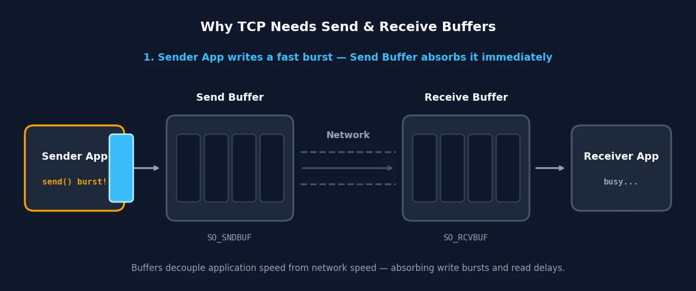

## Introduction

TBD — What are TCP send and receive buffers, why do people try to tune them, and what is this post going to explore?

## Anatomy of Linux TCP Buffers

### What Lives in the Send and Receive Buffers (`SO_SNDBUF` & `SO_RCVBUF`)

TBD — Explain the role of the send buffer (unacknowledged in-flight data + unsent data queued by the application) and the receive buffer (out-of-order segments + in-order unread data waiting for `recv()`), and how `SO_RCVBUF` drives the advertised TCP Receive Window (`rwnd`) and flow control.

### Bandwidth-Delay Product (BDP) and Why Buffer Size Dictates Throughput

TBD — Explain $\text{BDP} = \text{Bandwidth} \times \text{RTT}$ and how the effective window $\min(\text{cwnd}, \text{rwnd})$ limits maximum achievable throughput.

## How Linux Manages and Tunes TCP Buffers

### Kernel Dynamic Auto-Tuning (`tcp_moderate_rcvbuf` & Send Buffer Auto-Sizing)

TBD — How Linux dynamically scales receive and send buffers between `min`, `default`, and `max` based on RTT estimations, BDP, and system memory pressure.

### Kernel Parameters: `net.ipv4.tcp_rmem` / `tcp_wmem` vs `net.core.rmem_max` / `wmem_max`

TBD — The difference between the TCP-specific 3-tuple (`min`, `default`, `max`) used by auto-tuning and the core socket limits (`net.core.rmem_default`, `net.core.rmem_max`) that act as the ceiling for manual `setsockopt()` calls.

### Application-Level Overrides: `setsockopt(SO_RCVBUF)` and `setsockopt(SO_SNDBUF)`

TBD — How applications override buffer sizes per socket in code, and two critical Linux kernel behaviors:
1. **The 2x Multiplier Quirk**: Passing `val` to `setsockopt(SO_RCVBUF)` sets `sk_rcvbuf = 2 * val` (capped by `net.core.rmem_max`) to account for `sk_buff` kernel bookkeeping overhead.
2. **Disabling Auto-Tuning**: Setting `SO_RCVBUF` or `SO_SNDBUF` manually sets `SOCK_RCVBUF_LOCK` / `SOCK_SNDBUF_LOCK` on the socket, completely disabling dynamic kernel auto-tuning for that connection.

### Tuning in Containers and Kubernetes (Namespaced vs Host-Wide Sysctls)

TBD — How buffer tuning works in Docker/Kubernetes: why `net.ipv4.tcp_rmem` and `net.ipv4.tcp_wmem` are network-namespaced (per-pod configurable via `sysctl`), whereas `net.core.rmem_max` and `net.core.wmem_max` are host-wide (requiring Either host-level changes or forcing teams to fall back to `tcp_rmem` / code changes).

## Experimental Setup

TBD — Overview of our reproducible benchmark lab using Linux network namespaces, `tc netem` / `tbf` (for controlling bandwidth and latency), custom client/server socket instrumentation (recording `TCP_INFO`, advertised window, memory usage, and throughput over time), and plotting scripts.

## Benchmark Scenarios & Results

### Scenario 1: High BDP Link (Throughput Cap vs Auto-Tuning)

TBD — Simulating a high-bandwidth, high-latency link (e.g., 1 Gbps @ 50ms RTT). Comparing:
- Default kernel auto-tuning
- Small fixed `SO_RCVBUF` via `setsockopt()` (showing throughput hitting a hard wall)
- Large fixed `SO_RCVBUF` vs expanded `net.ipv4.tcp_rmem` max
- **Graphs**: Throughput over time, advertised `rwnd` / `sk_rcvbuf` growth over time.

### Scenario 2: Fast Sender, Slow Receiver (Flow Control, Zero-Window, and Buffer Bloat)

TBD — Simulating an application that reads slowly or stalls intermittently. Comparing how fixed oversized buffers accumulate massive unread queues (increasing latency/memory) vs smaller buffers / auto-tuning triggering TCP ZeroWindow backpressure earlier.
- **Graphs**: Application-level queueing delay, buffered bytes (`sk_rmem_alloc`), and ZeroWindow events over time.

### Scenario 3: High Concurrency & Memory Pressure (1,000s of Connections)

TBD — Simulating many concurrent connections to demonstrate the memory footprint trade-off:
- Manually pinning large `SO_RCVBUF` via `setsockopt()` across thousands of idle/slow connections (wasting RAM)
- Letting `tcp_rmem` auto-tuning keep idle/low-rate sockets near `default`/`min` while scaling up only active high-throughput flows
- **Graphs**: Total kernel TCP memory consumption (`ss -m` / `/proc/net/sockstat`) vs aggregate throughput.

### Scenario 4: Low-Latency Small Messages vs Bulk Transfers

TBD — Comparing ping-pong / RPC-style small-message workloads against bulk streaming transfers under different `SO_RCVBUF` / `SO_SNDBUF` and `tcp_rmem` / `tcp_wmem` configurations.
- **Graphs**: P50/P99 request-response latency vs bulk transfer bandwidth.

## Conclusion & Decision Matrix (TL;DR Cheat Sheet)

TBD — A practical decision table summarizing when to:
1. Leave kernel defaults alone (95% of workloads)
2. Tune `net.ipv4.tcp_rmem` / `tcp_wmem` per container/namespace (high-BDP pipes where `max` is too small, while preserving auto-tuning)
3. Use `setsockopt(SO_RCVBUF / SO_SNDBUF)` in application code (rare, specialized fixed-BDP or strict per-socket memory bounding cases)

---

If you liked this post, you can [support me on ko-fi](https://ko-fi.com/frosnerd).
